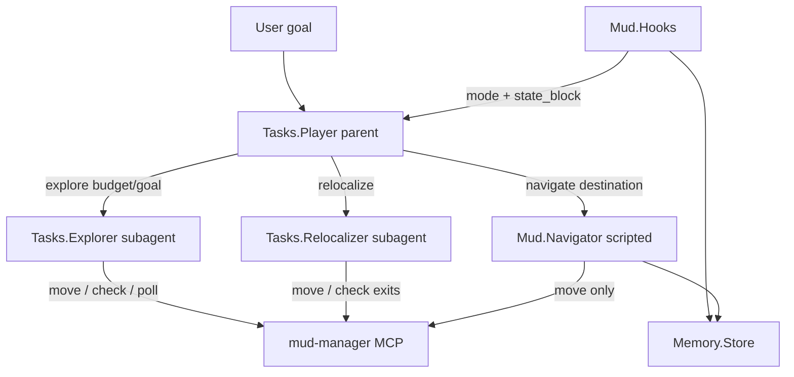

# Agents and Subagents (C + Ruby)

Extend Ruby `week2_capable/boukensha` so the player is a goal-layer orchestrator that delegates via `run_task` to Explorer and Relocalizer subagents, while closing the week_2_plan gaps (weighted routing, active relocalization, explicit mode) as deterministic Mud modules — not a greenfield Python rewrite.

## Context

[`week_2_plan.md`](../../week2_capable/week_2_plan.md) is a localization-first nav design (parse → graph → replan → frontier → candidate localization → weighted routes → relocalize → state machine → **LLM goals last**). Most of phases 0–5 already exist in Ruby:

| week_2 phase | Already in Ruby | Gap |
|---|---|---|
| 0–3 scaffold/parse/telnet/graph | `Mud::Memory::Store`, `RoomParser`, mud-manager MCP | none for product |
| 4 navigate + replan | `Navigator` + `RouteFinder` | unweighted BFS only |
| 5 frontier | `frontier_exits_for` + notes in navigate replies | **no explore loop** |
| 6 candidate localization | weak/strong fingerprints + `Hooks#disambiguate` | no scored `location_candidates` dict |
| 7 weighted/danger | — | missing |
| 8 active relocalize | provisional rooms logged | **no choose_disambiguating_action** |
| 9 state machine | implicit in Hooks | no explicit mode enum |
| 10 LLM goal layer | `Tasks::Player` + broad allowlist including `move` | player still picks `north`; no subagent product use |

Framework seam already exists and is tested: `Boukensha.run_task` (shared MCP, per-task allowlist, nested logger). **Nothing shipping calls it** — former `room_inspector` became scripted survey → lifecycle hook. New LLM subagents are only for judgment; walking/survey stay deterministic.

## Product architecture

**Invariant from week_2_plan Phase 10:** the parent never chooses a travel direction. Travel is `navigate` / `explore` / `relocalize` only. Combat, shop, social stay on the player.

### Agents

1. **`Tasks::Player`** (existing) — goal orchestrator
   - Narrow `tasks.player.allow`: **remove** bare `move(...)` for travel; keep combat/shop/social/examine/etc.
   - Keep native `navigate`.
   - Add native tools `explore` and `relocalize` that call `Boukensha.run_task(..., logger: logger)` so nested events land in one session (`test_delegated_session.rb` contract).
   - Prompt update: map intent → destination or “need to discover”; call tools; never invent directions.

2. **`Tasks::Explorer`** (new subagent) — Phase 5 as an agent
   - Config: `tasks.explorer` with tight allowlist: `move` (six dirs), `check(kind: exits)`, `poll`, `mud_status`.
   - Input: natural-language brief from player (“find a bakery”, “map 5 new rooms”).
   - Behavior: read frontier from state/tools, walk unknown exits, stop on found match / budget / blocked.
   - Own prompt under `prompts/explorer/` + optional `.boukensha/prompts/explorer/`.

3. **`Tasks::Relocalizer`** (new subagent) — Phase 8 as an agent
   - Config: `tasks.relocalizer`; allowlist: `move`, `check(kind: exits)`, `poll`.
   - Input: candidate room ids/names + ambiguity note from Hooks.
   - Prefer feeding it a **scripted** shortlist of disambiguating actions (Phase 8.1 as Ruby) so the LLM only picks among options — mirrors “LLM never invents north for routing.”

### Deterministic Mud upgrades (support the agents)

Do these in Ruby modules, not as LLM work:

- **`Mud::Localizer`** (Phase 6): `location_candidates: Hash[id => score]` with title/exit/feature/transition weights; wire into Hooks disambiguation.
- **`Mud::Disambiguator`** (Phase 8.1): `choose_disambiguating_action(candidates, store)` — command whose outcomes diverge most; Relocalizer (and optionally Hooks) consume it.
- **Edge costs** (Phase 7): store failure counts / danger flags on exits; `RouteFinder` uses weighted Dijkstra instead of unweighted BFS.
- **`Mud::Mode`** (Phase 9): small enum `localizing | navigating | exploring | relocalizing | combat` on Hooks.
- **`Mud::Explorer` composite**: scripted nearest-frontier loop under `tools.explore.allow`; player tool uses scripted path for `map N rooms`, escalates to `Tasks::Explorer` for open-ended “find X”.

### Wiring files

- New: `lib/boukensha/tasks/explorer.rb`, `relocalizer.rb`
- New: `lib/boukensha/mud/localizer.rb`, `disambiguator.rb`, `explorer.rb`, `mode.rb` (and tests)
- Edit: `boukensha_loader.rb` — register `explore` / `relocalize` native tools with `logger:` from RunDSL
- Edit: `boukensha.rb` — `require` new task classes
- Edit: `.boukensha/settings.yaml` — `tasks.explorer`, `tasks.relocalizer`, narrowed `player.allow`, `tools.explore`
- Edit: `prompts/system.md` + new explorer/relocalizer prompts
- Tests: delegated-session pattern; Localizer/Disambiguator/RouteFinder weights; scripted explore

## Execution sessions

### Session 1 — Framework product seam
Implement `Tasks::Explorer` + `Tasks::Relocalizer`, settings blocks, native `explore`/`relocalize` tools via `run_task`, prompt files, narrow player `move` removal. Gate: nested session logging.

### Session 2 — Localizer + Disambiguator
Scored candidates + disambiguating-action picker with fixture tests (identical-title rooms).

### Session 3 — Wire into Hooks + Relocalizer
Hooks uses Localizer; on ambiguity set mode `relocalizing`; `relocalize` tool briefs Relocalizer.

### Session 4 — Frontier explore loop
Explorer prompt + allowlist; scripted `Mud::Explorer` for nearest-frontier; player `explore` delegates.

### Session 5 — Weighted routing
Edge cost + failure tracking; RouteFinder Dijkstra; dangerous-edge avoidance fixtures.

### Session 6 — Mode enum + guardrails
`Mud::Mode` transitions; player prompt/allowlist must not advertise travel `move`.

## Out of scope

- Greenfield Python `bokensha/{model,localize,...}` from week_2_plan Phase 0
- Replacing scripted `RoomSurvey` with an LLM inspector again
- Python port of `run_task` into week1 `12_context`
- mud_monitor UI changes (nested task spans already flow if logger stamps `task`)
